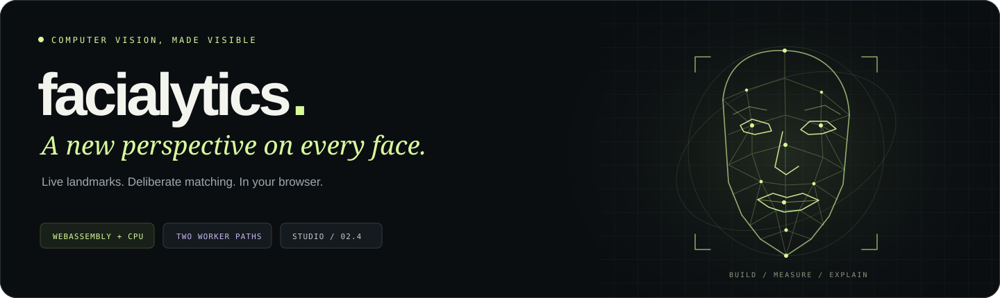
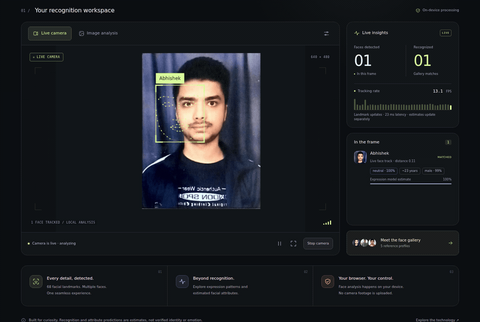
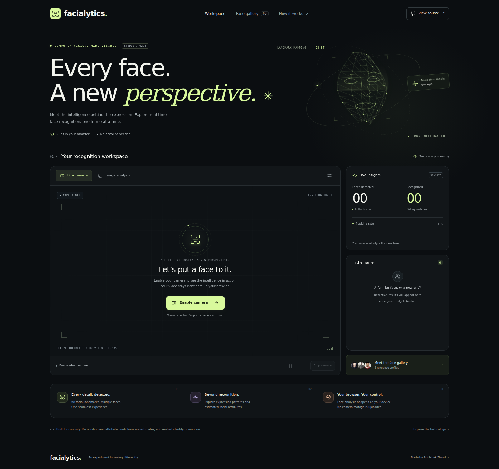
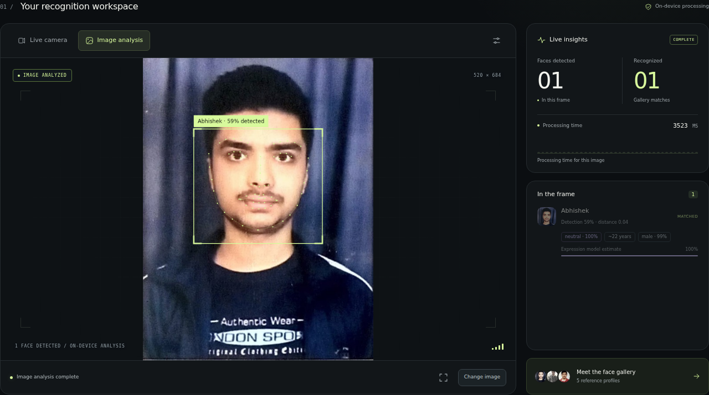
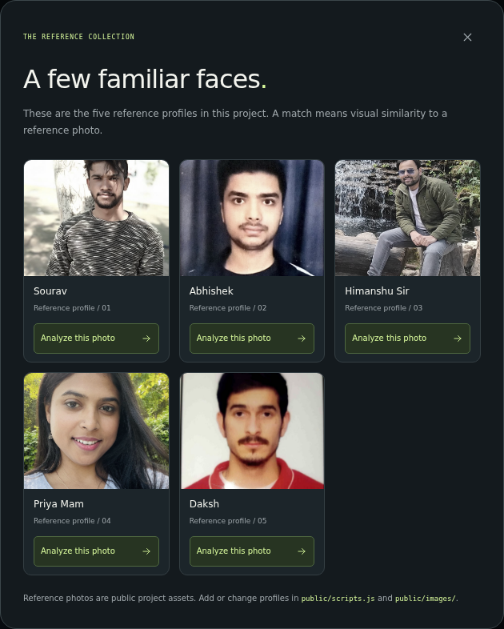
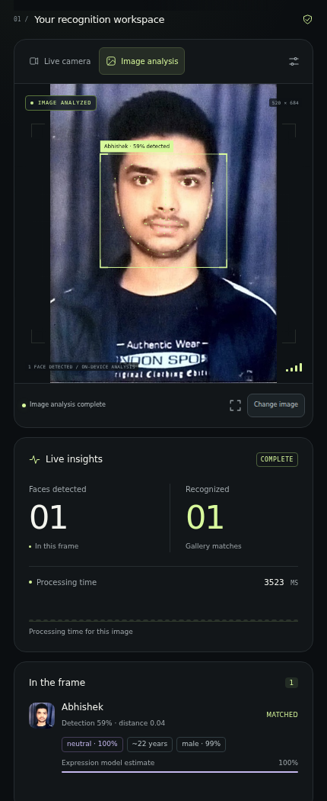
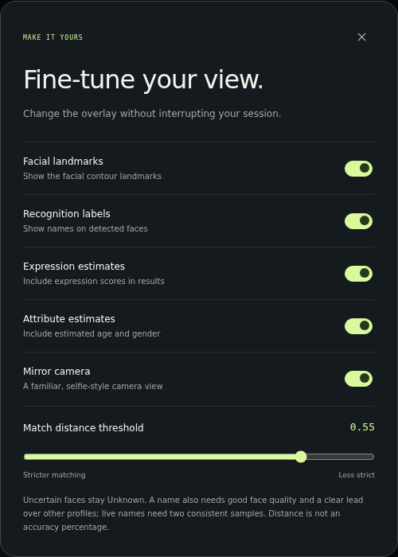
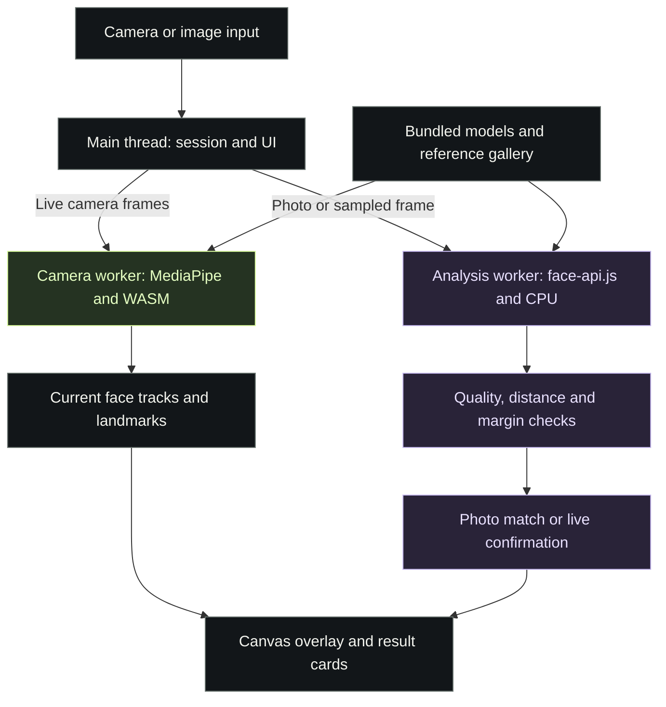
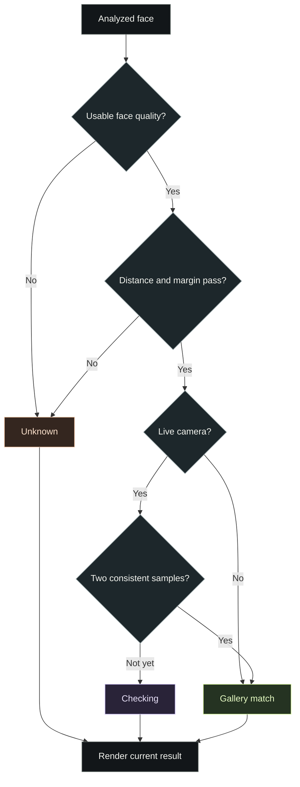

<p align="center">
  
</p>

<h1 align="center">Facialytics Studio</h1>

<p align="center">
  A browser computer vision studio for live facial landmarks, reference-gallery matching,<br>
  and image analysis—with independent workers for tracking and recognition.
</p>

<p align="center">
  <a href="https://facialytics.vercel.app/"><strong>Launch the studio ↗</strong></a>
  &nbsp; · &nbsp; <a href="#quick-start">Run locally</a>
  &nbsp; · &nbsp; <a href="#architecture">Architecture</a>
  &nbsp; · &nbsp; <a href="#roadmap">Roadmap</a>
</p>

<p align="center">
  <strong>JavaScript</strong> &nbsp; / &nbsp; Web Workers &nbsp; / &nbsp; WebAssembly &nbsp; / &nbsp; face-api.js &nbsp; / &nbsp; Vercel
</p>

---

## See it in motion

[](https://facialytics.vercel.app/)

<sub>Captured from the deployed Studio 02.4 interface. This clip replays the bundled Abhishek portrait through a moving synthetic camera stream; model inference and overlays are real. It demonstrates the workflow, not physical-webcam accuracy or a speed guarantee. [Static frame](assets/readme/live-tracking.png) · [Media provenance](assets/readme/MEDIA.md).</sub>

**Move a face. Inspect the result. Understand the pipeline.** Facialytics separates fast landmark updates from slower recognition and estimate models, so detailed analysis can complete without holding up every overlay update.

| Capability | What you can explore |
| --- | --- |
| **Live camera** | Facial contours, bounding boxes, names after confirmation, measured tracking rate and latency. |
| **Image analysis** | JPG, PNG and WebP input; multiple-face detection; a built-in sample that needs no webcam. |
| **Reference gallery** | Five bundled profiles, prepared descriptors and an **Analyze this photo** action for each profile. |
| **Matching controls** | Descriptor-distance threshold, ambiguity rejection, image-quality checks and Unknown results. |
| **Session controls** | Start, stop, pause, resume, mirror, fullscreen and input switching. |
| **Local processing** | Camera frames and selected images stay in the browser; models and reference assets are served with the app. |

**Explore:** [Screenshots](#screenshots) · [Quick start](#quick-start) · [Architecture](#architecture) · [Recognition policy](#recognition-policy) · [Development](#development) · [Deployment](#deployment) · [Roadmap](#roadmap) · [Scope and attribution](#scope-and-attribution)

## Screenshots

### The studio

[](assets/readme/studio-overview.png)

### Image analysis and reference gallery

| A completed analysis | The reference collection |
| --- | --- |
| [](assets/readme/image-analysis.png) | [](assets/readme/face-gallery.png) |

### Mobile and controls

<table>
  <tr>
    <td align="center" width="50%"><strong>Mobile workspace</strong></td>
    <td align="center" width="50%"><strong>Recognition and overlay settings</strong></td>
  </tr>
  <tr>
    <td align="center"><a href="assets/readme/mobile-studio.png"></a></td>
    <td align="center"><a href="assets/readme/recognition-settings.png"></a></td>
  </tr>
</table>

<sub>Fresh captures of the deployed interface. Result cards contain actual model output for the supplied reference photo. Expression and demographic values are estimates.</sub>

## Quick start

**Requirements:** Node.js 22 or 24, npm, and a recent Chrome, Edge or Firefox browser. Camera mode needs a webcam and browser permission.

```bash
git clone https://github.com/Abhii26/Facialytics.git
cd Facialytics
npm ci
npm start
```

Open **[http://localhost:4000](http://localhost:4000)**. The current interface is labeled **STUDIO / 02.4**.

1. **First run:** select **Image analysis → Or try a gallery photo**. Models are bundled, and this route needs no camera.
2. **Explore profiles:** open **Face gallery**, then choose **Analyze this photo**.
3. **Go live:** select **Live camera → Enable camera**, allow access, and wait for initialization and warm-up.
4. **Watch both paths:** landmarks update independently; names need consistent recognition samples and can take longer to appear.
5. **Finish:** select **Stop camera** to release the webcam.

<details>
<summary><strong>ZIP setup, another port and local HTTPS</strong></summary>

For a ZIP download, extract into a new folder and run `npm ci` and `npm start` in the folder containing `package.json`. See [START_HERE.md](START_HERE.md).

Use a different port if 4000 is occupied:

```bash
# Linux / macOS
PORT=5000 npm start
```

```powershell
# Windows PowerShell
$env:PORT = "5000"
npm start
```

The local server uses HTTP by default. If existing `certs/create-ca.pem` and `certs/create-ca-key.pem` files are present, it uses HTTPS; follow the URL printed in the terminal. Camera access requires HTTPS or localhost. Open the app through its server rather than opening the HTML file directly.

</details>

## Architecture

**Two workers, two cadences.** The main thread manages media, sessions, canvas drawing and result cards. The camera worker produces current landmarks. The analysis worker runs face-api.js detection, descriptors and optional estimates on a sampled camera frame or an uploaded image.



| Path | Implementation | Engineering detail |
| --- | --- | --- |
| **Live landmarks** | MediaPipe Face Landmarker, CPU/WebAssembly | Maps the mesh to a 68-point contour display; configured for up to five live faces. |
| **Recognition** | Tiny Face Detector, tiny landmark network and face-recognition network | Produces 128-value descriptors, then compares them with the gallery. |
| **Estimates** | Optional expression and age/gender models | Loaded when needed and kept outside the fast landmark path. |
| **Continuity** | Geometric association and a normalized appearance patch | Invalidates stale identity information when a track is lost or appearance changes. |
| **Gallery cache** | Prepared descriptors plus SHA-256 photo checks | Reuses matching cached profiles; changed photos are processed again. |

### How work is scheduled

- **One current tracking frame at a time.** The next frame uses `requestVideoFrameCallback`, with a timer fallback. Camera frames do not build an inference backlog.
- **One analysis request at a time.** New live names use descriptor-only passes first; full estimates follow separately. The initial confirmation gap is 250 ms after completion; the full-detail gap is one second.
- **Session-aware results.** Stop, pause/resume, hidden tabs and input switching invalidate earlier work. Camera tracks are released on stop.
- **Fresh overlay positions.** Delayed recognition enriches a current track; it does not replace current landmark coordinates. Tracking results older than 300 ms are discarded, and a stalled overlay clears after 350 ms.

<details>
<summary><strong>Repository map and input limits</strong></summary>

| Location | Responsibility |
| --- | --- |
| `public/index.html`, `public/styles.css` | Responsive interface, dialogs, accessibility and visual system. |
| `public/scripts.js` | Media lifecycle, worker requests, matching integration and rendering. |
| `public/camera-engine.js` | Fast video landmarks and appearance signatures. |
| `public/face-engine.js` | Model loading, image analysis, descriptors and quality measurements. |
| `public/recognition-policy.js` | Descriptor validation, threshold and ambiguity decisions. |
| `public/face-tracks.js` | Track continuity and repeated live confirmation. |
| `public/gallery-descriptors.json` | Cached reference vectors and photo hashes. |
| `public/models/`, `public/vendor/mediapipe/` | Bundled neural models and SIMD/non-SIMD runtime assets. |
| `public/images/` | Public reference photos. |
| `server.js`, `scripts/check-install.cjs` | Local static server and required-asset checks. |
| `tests/` | Server, asset, policy and tracking regression checks. |
| `assets/readme/` | Current documentation screenshots, animation and artwork. |

Image uploads accept JPG, PNG and WebP up to 12 MiB; the interface labels this as 12 MB. Display images are bounded to a 960-pixel long edge, and recognition input to 640 pixels. Large group images can lose small-face detail during resizing. Browser/device load and face count affect execution time.

</details>

## Recognition policy

**The nearest profile is a candidate, not an identity guarantee.** A name also needs a usable face image, sufficient descriptor similarity, separation from the next profile and—in camera mode—consistent evidence from distinct samples.



### Current Studio 02.4 configuration

| Setting | Current value | Source |
| --- | --- | --- |
| Default descriptor-distance limit | **0.55** | `recognition-policy.js` |
| Matching-code maximum | **0.60** | `recognition-policy.js` |
| Settings slider range | **0.30–0.55** | `index.html` |
| Minimum lead over the second profile | **0.03** | `recognition-policy.js` |
| Live confirmation | **Two distinct consistent samples** | `face-tracks.js` |
| Maximum descriptor drift between confirmation samples | **0.40** | `face-tracks.js` |

The current runtime differs from the earlier 0.42/0.08 configuration described in the historical correction notes. These values are operating defaults, not statistical calibration. Lower distance limits and larger separation margins make acceptance stricter; distance is not an accuracy percentage. Rejected faces display **Unknown**.

<details>
<summary><strong>Quality gates and reference-gallery changes</strong></summary>

Current quality checks require a detection score of at least 0.42 and a face of at least 28 pixels in its smaller inference dimension. A 64 × 64 sample is also checked for brightness, contrast and Laplacian sharpness. They filter poor inputs but do not establish a measured false-accept rate.

To update the gallery, edit `faceList` in `public/scripts.js` and place the corresponding photos in `public/images/`:

```javascript
const faceList = [
  { name: "Abhishek", imagePath: "images/abhishek.jpg" },
  { name: "New profile", imagePath: "images/new-profile.jpg" }
];
```

Use clear reference portraits you have permission to publish. A changed photo hash triggers descriptor regeneration. The gallery dialog follows `faceList`; decorative profile counts and avatar strips are currently styled for the original five profiles and need manual adjustment when that number changes.

</details>

## Development

```bash
npm run dev     # Local server with nodemon
npm run check   # JavaScript syntax checks
npm test        # Node test suite
```

### Validation status

Reviewed against the deployed Studio 02.4 source on **29 October 2026**:

| Check | Result |
| --- | --- |
| JavaScript syntax | Passes `npm run check`. |
| Automated regression suite | **22 of 25 pass**; three recognition-policy assertions conflict with the current relaxed defaults. |
| Documentation capture | Live site loaded, sample photo matched, dialogs and mobile layout rendered, and camera replay completed without uncaught page errors. |
| Recognition accuracy | No population accuracy or false-accept-rate claim is made. |

The three policy failures cover a distant nearest neighbor, a small first/second margin, and the maximum allowed threshold. Decide the intended acceptance policy, calibrate it with independent known/unknown samples, and resolve those assertions before claiming a clean regression run. See the first roadmap item.

### Contributing

1. Create a focused branch from `main`.
2. Describe the user-visible behavior you are changing.
3. Run syntax checks and the relevant tests; explain any remaining failures.
4. Exercise image input, known/unknown faces and camera lifecycle when affected.
5. Open a pull request with reproduction steps, validation and screenshots for UI changes.

[Report a bug](https://github.com/Abhii26/Facialytics/issues/new) with the browser/version, OS, input mode, steps, expected/actual behavior and the visible error. Use reference or anonymized test material rather than publishing another person's private photo.

## Deployment

The browser app is static. Express provides the local server; Vercel serves `public/` directly.

| Vercel setting | Value |
| --- | --- |
| Framework preset | **Other** |
| Root directory | Repository root |
| Build command | Empty |
| Output directory | `public` |
| App API keys or database | None required |

The repository includes the corresponding [vercel.json](vercel.json). Keep the complete `public/models/` and `public/vendor/mediapipe/` directories in the deployment.

**Update workflow:** create a working branch → open a pull request → test its Vercel preview → merge into the configured production branch. Keep the existing Vercel project and its production domain when updating the same live URL. Save a backup branch before a major replacement if you want an easy source snapshot.

See [UPGRADE.md](UPGRADE.md) and the [Vercel Git deployment guide](https://vercel.com/docs/git). Historical documents describe their original version; the configuration table above reflects Studio 02.4.

<details>
<summary><strong>Troubleshooting</strong></summary>

| Symptom | Check |
| --- | --- |
| Old interface appears | Confirm the deployment/branch and hard-refresh with Ctrl+Shift+R. |
| Camera is unavailable | Use HTTPS or localhost, allow browser permission and close other camera apps. |
| Model or WASM download fails | Confirm the complete model/vendor folders are deployed and requests return the correct files. |
| Names take longer than landmarks | Recognition and estimates run separately; a live name needs consistent samples. |
| A known face remains Unknown | Try a sharp, evenly lit frontal view. Inspect the distance and quality result before changing thresholds. |
| Several small faces are missed | Try a closer or more tightly framed image; resized group inputs can lose detail. |
| Local startup reports an incomplete folder | Re-extract the complete project and follow the missing paths printed by the installation check. |

</details>

## Roadmap

Delivered foundations include the dual-worker pipeline, current-frame scheduling, reference-photo hash checks, Unknown handling, repeated live confirmation, session cleanup and responsive input controls.

The next steps below are **proposed work**, not shipped features or dated commitments.

| Priority | Next step | Definition of done |
| --- | --- | --- |
| **P0** | Resolve acceptance-policy/test mismatch | Choose and document the intended rules; the regression suite and UI controls agree with them. |
| **P0** | Evaluate independent known/unknown faces | Publish dataset scope, holdout procedure and false-accept/false-reject results with limitations. |
| **P1** | Multiple reference views per person | Add a clear enrollment workflow and evaluate it without simply widening acceptance thresholds. |
| **P1** | Browser checks in CI | Automate camera lifecycle, permission/model failures, photo analysis and screenshot regressions. |
| **P2** | Browser/device performance matrix | Report warm-up, tracking latency, details cadence, face count and test conditions across devices. |
| **P2** | Maintainability and release hygiene | Add the intended root license, versioned model-asset checks and release notes tied to tested source. |

## Scope and attribution

Facialytics is a computer vision demonstration. Matching is visual similarity to public reference photos; it is not authentication, identity verification or liveness detection. Expression and demographic estimates can be wrong. There is no attendance database or private enrollment service.

Camera frames and selected images are processed in the browser and are not uploaded or saved by the app. Model files and bundled gallery photos are public assets downloaded by visitors. There are no application analytics or external AI inference endpoints in this implementation.

The package declares **ISC** metadata, but the repository currently has no standalone root `LICENSE` file. Bundled dependencies and model assets retain their own terms; see [THIRD_PARTY_NOTICES.md](THIRD_PARTY_NOTICES.md) and the included [MediaPipe license](public/vendor/mediapipe/LICENSE).

Built with [face-api.js](https://github.com/justadudewhohacks/face-api.js), [MediaPipe](https://github.com/google-ai-edge/mediapipe), browser media/canvas APIs, Node.js and Express.

---

<p align="center">
  <strong>Built by <a href="https://github.com/Abhii26">Abhishek Tiwari</a></strong><br>
  <a href="https://facialytics.vercel.app/">Open the studio</a> ·
  <a href="https://github.com/Abhii26/Facialytics">Explore the source</a> ·
  <a href="https://github.com/Abhii26/Facialytics/issues">Discuss an improvement</a>
</p>
