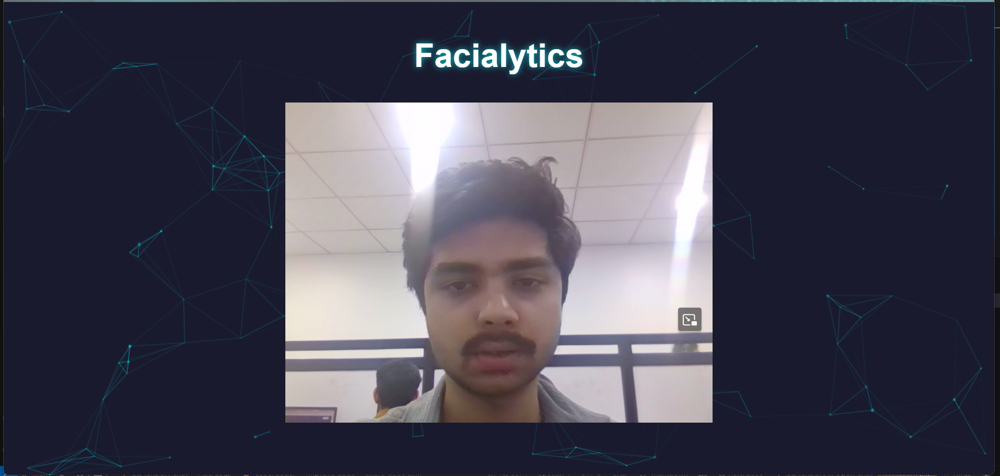
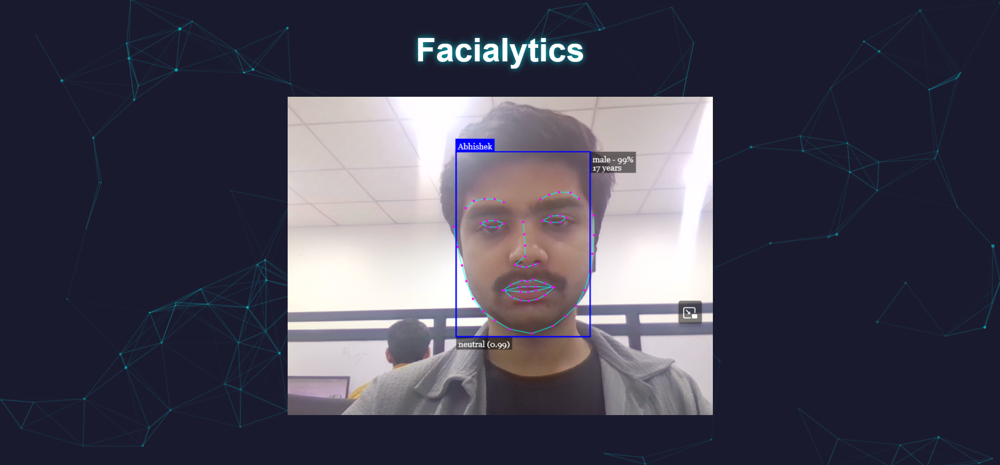
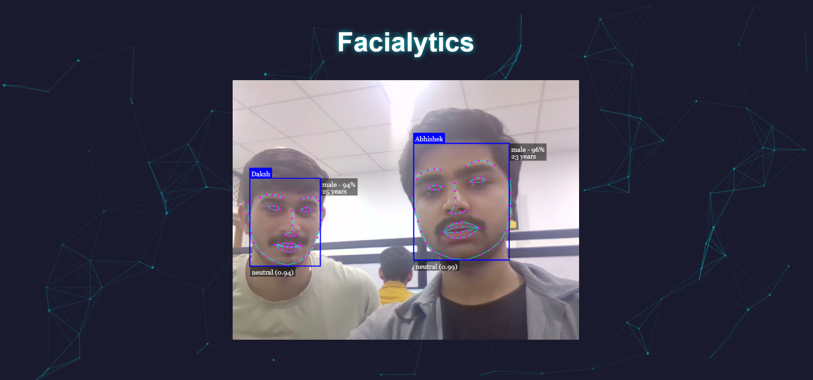
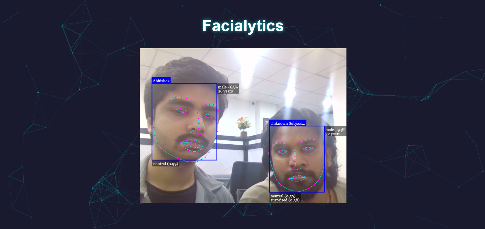
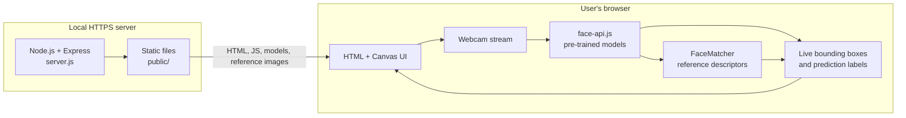
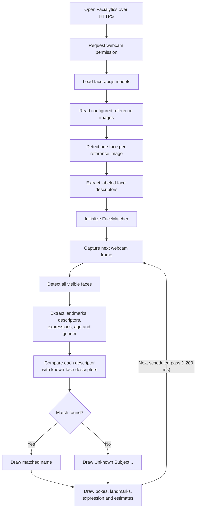

<div align="center">

# 🎭 Facialytics

### Real-Time Face Recognition & Facial Expression Analysis

**A browser-based computer vision project built with JavaScript, Node.js, Express, and face-api.js.**  
Detect multiple faces from a live webcam, identify people from a configured reference-image gallery, and visualize facial expressions, landmarks, and estimated attributes on screen.


-blue)
[](https://facialytics.vercel.app/)

**[🚀 Launch Live Demo](https://facialytics.vercel.app/)** · **[Explore the workflow](#how-it-works)** · **[View screenshots](#application-preview)** · **[Run locally](#getting-started)** · **[Understand the architecture](#system-architecture)**

</div>

---

## 🚀 Live Demo — Vercel

**Facialytics is available online:** **[https://facialytics.vercel.app/](https://facialytics.vercel.app/)**

Open the live application in a camera-enabled browser to explore the real-time face detection, facial expression analysis, multiple-face overlays, and reference-image matching experience.

**Try the demo:**

1. Open the **[Facialytics Live Demo](https://facialytics.vercel.app/)**.
2. Allow the browser to access your camera when prompted.
3. Wait for the face detection and recognition models to load.
4. Position one or more faces within the camera view to see the live overlay, recognition labels, and expression estimates.

> **Demo notes:** Browser camera access requires permission and a secure context (HTTPS). Results depend on lighting, camera quality, browser compatibility, and the preconfigured reference-image gallery. This is a portfolio demonstration, not a security-grade biometric verification system.

## Project overview

**Facialytics** demonstrates how to combine a live camera stream with deep-learning models running in the browser. After the user grants camera access, the app detects faces, predicts expression categories, estimates age and gender, and compares face descriptors with a small set of reference images to display a known person's label or an **unknown** result.

In local development, the **Node.js/Express backend serves files over HTTPS**; a **[hosted demo is also available on Vercel](https://facialytics.vercel.app/)**. Face detection, inference, comparison, and canvas rendering happen in the **browser**, using a bundled `face-api.js` library and pre-trained models from `public/models/`. There is no database, login flow, or server-side recognition API in the uploaded implementation.

> **Project scope:** This is an educational and portfolio computer-vision prototype, not an identity-verification, biometric security, or emotion-assessment product. Predicted expressions and demographic attributes are estimates and can be inaccurate.

## Application preview

Screenshots included with this repository (click to open the full image on GitHub):

<div align="center">
  <a href="assets/homepage.png"></a>
</div>

<table>
  <tr>
    <td width="50%" align="center"><a href="assets/personrecognition.png"></a><br /><strong>Known-face matching</strong></td>
    <td width="50%" align="center"><a href="assets/multiuserrecognition.png"></a><br /><strong>Multi-face detection</strong></td>
  </tr>
  <tr>
    <td colspan="2" align="center"><a href="assets/unkownuseridentification.png"></a><br /><strong>Unknown-face identification</strong></td>
  </tr>
</table>

> Screenshot paths match the files in this repository, including the existing filename `unkownuseridentification.png`.

## Features

| Feature | How it's implemented |
| --- | --- |
| **Live webcam feed** | Browser `navigator.mediaDevices.getUserMedia()` with video enabled and audio disabled. |
| **Multiple-face detection** | `faceapi.detectAllFaces()` processes the current video frame. |
| **Face landmarks** | 68-point landmark detection is used to analyze and draw facial features. |
| **Expression predictions** | The expression model annotates detected faces with predicted expression labels/scores. |
| **Age and gender estimates** | An age/gender model displays estimated age, predicted gender, and confidence. |
| **Known-person recognition** | Reference images are converted into labeled face descriptors and compared via `faceapi.FaceMatcher`. |
| **Unknown-person labeling** | Results that fail matching are rendered as `Unknown Subject...`. |
| **Multi-person overlays** | Bounding boxes, landmarks, expressions, demographics, and match labels render onto a canvas. |
| **Repeated analysis** | A detection pass is scheduled every **200 ms**; actual throughput depends on hardware and inference time. |
| **Local HTTPS development** | Express serves the app using an HTTPS key/certificate pair generated separately. |

**Not currently implemented in the provided source:** uploading an image through the UI, registering identities through an enrollment form, saving recognition events, database-backed galleries, or authentication. The project now has a **[hosted demo](https://facialytics.vercel.app/)**; these additional features remain possible future extensions.

## System architecture

The architecture below shows the app's browser-side inference pipeline and the Express-based **local development server**. The public demo is hosted separately on **[Vercel](https://facialytics.vercel.app/)**.



### Responsibilities by layer

| Layer | Implementation | Responsibility |
| --- | --- | --- |
| Web server | `server.js`, Express 5 | Serve frontend scripts, images, and model weights over HTTPS. |
| Interface | `public/index.html` | Display the video, canvas overlay, and decorative particle background. |
| AI pipeline | `public/scripts.js` | Open webcam, load models, detect faces, match descriptors, and render results. |
| AI runtime | `public/face-api.min.js`, `public/models/` | Run face analysis and descriptor inference inside the browser. |
| Reference gallery | `public/images/`, `faceList` array | Provide the configured labeled images used by the matcher. |

The particle background is loaded from a CDN; the app's face-api.js bundle, model files, and reference images are hosted locally by Express.

## How it works

### End-to-end recognition workflow



**Processing sequence:**

1. `getUserMedia()` asks for webcam access and assigns the stream to the `<video>` element.
2. The browser loads five neural-network components: **SSD MobileNet V1**, **68-point face landmarks**, **face recognition**, **age/gender**, and **expression recognition**.
3. `loadLabeledFaceDescriptors()` reads the configured reference photos, detects one face per image, and creates `LabeledFaceDescriptors` entries. Images with no detected face are skipped.
4. A `FaceMatcher` compares descriptor vectors from webcam faces to those labeled reference descriptors.
5. Every scheduled pass calls `detectAllFaces(...).withFaceLandmarks().withFaceDescriptors().withFaceExpressions().withAgeAndGender()`.
6. The canvas is cleared and refreshed with face boxes, landmark points, expression overlays, age/gender estimates, and a matched label or an unknown label.

> **Performance note:** `setInterval(..., 200)` is a scheduling interval, **not a guaranteed 5 FPS processing speed**. Inference is asynchronous, so slow devices may have overlapping in-flight passes. A sequential inference loop is a potential improvement.

### Recognition behavior

| Input | Output |
| --- | --- |
| A face resembling one of the configured reference images | Best-matching configured label, subject to the library's matcher threshold. |
| A face with no sufficiently close reference match | `Unknown Subject...` label. |
| Multiple faces in one frame | Each detected face receives its own analysis and match label. |
| A reference image with no detectable face | A warning in the browser console; that reference is skipped. |

The project does not provide measured recognition accuracy, demographic accuracy, or a production-tested decision threshold. Do not interpret a displayed label as verified identity.

## Technology stack

| Area | Technology |
| --- | --- |
| Backend runtime | Node.js |
| Static web server | Express.js 5 |
| Computer vision | `face-api.js` (browser-side) |
| Detection network | SSD MobileNet V1 |
| Additional models | 68-point landmarks, face recognition, expressions, age/gender |
| Frontend | HTML, CSS, vanilla JavaScript |
| Live video | WebRTC browser media API (`getUserMedia`) |
| Overlays | HTML Canvas / face-api.js drawing utilities |
| Local HTTPS | Node.js `https` module, mkcert-generated development certificate |
| Development tooling | npm, nodemon |
| UI animation | particles.js (CDN) |

## Project structure

```text
Face_Recognition-main/
├── assets/                              # README screenshots
│   ├── homepage.png
│   ├── personrecognition.png
│   ├── multiuserrecognition.png
│   └── unkownuseridentification.png
├── public/                              # Files served to the browser
│   ├── images/                          # Known-person reference photographs
│   ├── models/                          # Pre-trained face-api.js model manifests/weights
│   ├── face-api.min.js                  # Bundled browser AI runtime
│   ├── index.html                       # Camera UI and canvas
│   └── scripts.js                       # Recognition pipeline and rendering
├── .gitignore                           # Ignores node_modules, .env, certs, etc.
├── package.json                         # Dependencies and npm scripts
├── package-lock.json                    # Locked dependency resolution
├── server.js                            # HTTPS Express static server
└── README.md                            # Project documentation

# Generated locally when following setup below:
# certs/                                 # Local certificates; NOT checked into Git
# node_modules/                          # npm-installed packages; NOT checked into Git
```

## Getting started

**Fastest option:** Open the **[live web demo](https://facialytics.vercel.app/)** and allow webcam permissions. The following instructions are for running the source locally.

### Prerequisites

- **Node.js and npm** installed.
- **mkcert** installed for a locally trusted HTTPS development certificate.
- A modern browser with webcam support (such as Chrome, Edge, or Firefox).
- A working webcam and permission to use it.

> **Local setup note:** The uploaded source ZIP does **not** contain the HTTPS certificate files expected by `server.js`. Generate these when running the local server. To try the app without local setup, use the **[live Vercel demo](https://facialytics.vercel.app/)**.

### 1. Get the project

Clone the GitHub repository using its actual URL, or download the source ZIP and extract it. Open a terminal in the folder containing `package.json` and `server.js`.

### 2. Install dependencies

```bash
npm install
```

### 3. Generate local HTTPS certificates

Install mkcert according to its operating-system instructions, then run **from the project root**:

```bash
mkcert -install
mkdir -p certs
mkcert -cert-file certs/create-ca.pem -key-file certs/create-ca-key.pem localhost 127.0.0.1 ::1
```

The chosen filenames matter because `server.js` expects exactly:

```text
certs/create-ca.pem       # HTTPS certificate
certs/create-ca-key.pem   # Private key: keep secret
```

Despite the filenames, these are the **local server certificate and private key** created by mkcert—not certificate-authority files you should publish.

**Never commit `certs/` or its private key.** It is already ignored by `.gitignore`.

### 4. Start the server

```bash
node server.js
```

Or use the existing development script, which starts `nodemon`:

```bash
npm start
```

By default, the project listens on **port 4000**, not 5000. Open:

**https://localhost:4000**

If port 4000 is unavailable, set `PORT` before starting (macOS/Linux example):

```bash
PORT=5000 node server.js
```

Then visit `https://localhost:5000`. The port can change, but the application still expects the certificate paths listed above.

### 5. Use the application

1. Allow **camera access** in the browser.
2. Let the browser load the bundled detection and recognition models.
3. Face the camera; the app should draw detection boxes and attribute labels on the live feed.
4. Compare how it labels faces present in the configured reference gallery versus unfamiliar faces.
5. Open the browser's **Developer Tools → Console** for model/reference-image warnings or other runtime errors.

**Note:** Model loading and the first inference can take longer than subsequent passes. Actual behavior varies with browser, computer, lighting, image quality, and camera access.

## Customize the reference gallery

The reference gallery is configured manually in `public/scripts.js`:

```javascript
const faceList = [
  { name: "Person One", imagePath: "images/person-one.jpg" },
  { name: "Person Two", imagePath: "images/person-two.jpg" }
];
```

To use your own **consented** demonstration photos:

1. Place the images in `public/images/`.
2. Update the `faceList` array with the intended labels and relative image paths.
3. Use photos where one face is clearly visible; the current loader calls `detectSingleFace()` once for each image.
4. Refresh the browser so descriptors are regenerated from the updated gallery.

Each valid reference image contributes **one descriptor** to its label in this implementation. There is no enrollment database or persistent management interface.

> **Code observation:** The current script also loads a separate reference photo (`images/sourav.jpg`) for an additional single-face detection check. Its result is not used to create the multi-person `FaceMatcher`, but if detection fails the function returns before the recurring webcam analysis begins. When changing the gallery, update or remove this additional dependency in code as appropriate.

## Configuration and key files

| Setting / file | Current behavior |
| --- | --- |
| `process.env.PORT` | Default **4000** (`server.js`). |
| `faceList` | Labeled reference images in `public/scripts.js`. |
| `setInterval(..., 200)` | Schedules recognition processing approximately every **200 ms**. |
| `new faceapi.FaceMatcher(labeledDescriptors)` | Uses face-api.js default matching behavior; no custom threshold is provided in the script. |
| `public/models/` | Must contain the required model manifests and weights. |
| `certs/create-ca.pem` + `certs/create-ca-key.pem` | Local HTTPS certificate/key, generated by you. |

The `dotenv` package is installed, but `server.js` does not currently load a `.env` file. Supply `PORT` through your shell environment if you need to override it.

## Troubleshooting

| Problem | What to check |
| --- | --- |
| `ENOENT: no such file or directory, open './certs/create-ca-key.pem'` | Generate the certificate and private key with the exact filenames shown above. Run commands from the project root. |
| Webcam permission denied or video remains blank | Open the HTTPS URL, allow camera access, close other webcam applications, and check browser permissions. |
| Model load errors / network 404s | Confirm `public/models/` contains the referenced manifest and shard files and inspect the browser Network tab. |
| Reference image cannot be matched | Check the image path in `faceList`, whether the photo contains one clear face, and console warnings. |
| No live analysis after page loads | Inspect the browser console. The script exits its startup function when the additional single-reference image check fails. |
| Browser shows certificate warning | Run `mkcert -install`, regenerate the local certificate, and use the exact hostname covered by the certificate. |
| Slow or flickering overlays | Reduce competing CPU/GPU load; the current recurring asynchronous passes aren't serialized. |

## Privacy, responsible use, and limitations

**Privacy and responsible use**

- Face reference images under `public/images/` are **static, server-accessible files**. If this project is hosted publicly, those images may become accessible to visitors. Do not publish real people's biometric reference photos without appropriate permission and rights.
- The browser performs face analysis locally in this implementation, but it **downloads the static models and reference photos from the serving origin**. There is no code to upload webcam frames to a recognition backend.
- Do not rely on expression, age, or gender estimates to determine a person's real emotions, traits, or eligibility.
- Use this project with informed consent and follow applicable privacy laws.

**Current technical limitations**

- No upload-image flow, registration UI, persistent identity database, access control, or analytics storage.
- No automated tests: `npm test` currently contains the package's placeholder failing command.
- No measured accuracy, threshold tuning study, or performance benchmark.
- The fixed **720 × 580** video element and absolute-positioned canvas have not been implemented as a responsive design system.
- The checked-in local HTTPS server relies on filesystem certificate files. The **[Vercel demo](https://facialytics.vercel.app/)** is a separate hosted deployment; the local server configuration should not be assumed to be directly portable to every static or serverless platform.
- Recognition depends on preconfigured face images and network-accessible static assets; the particle visual effect uses an external CDN.

## Roadmap

- [ ] Add image-upload analysis and drag-and-drop preview.
- [ ] Replace hardcoded gallery entries with an opt-in identity enrollment interface.
- [ ] Add configurable recognition thresholds and multiple reference images per identity.
- [ ] Implement a single-flight inference loop to prevent overlapping model passes.
- [ ] Add responsive webcam/canvas sizing and accessible controls.
- [ ] Improve loading states and camera/model error feedback.
- [ ] Add automated tests, code formatting, and CI checks.
- [ ] Document recognition accuracy, speed, and limitations using an appropriately consented test dataset.
- [x] Publish a browser-accessible demo on **[Vercel](https://facialytics.vercel.app/)**.
- [ ] Review hosted reference-image visibility and ensure private photos or development TLS keys are never deployed.

## Contributing

Contributions, fixes, and suggestions are welcome. Please open an issue describing the proposed change, create a feature branch, and submit a pull request. Avoid including real users' facial images, credentials, or private certificates in issues or commits.

## References and acknowledgements

- [face-api.js — documentation and model API](https://github.com/justadudewhohacks/face-api.js)
- [mkcert — locally trusted development certificates](https://github.com/FiloSottile/mkcert)
- [Express — web framework](https://expressjs.com/)
- [MDN — getUserMedia](https://developer.mozilla.org/en-US/docs/Web/API/MediaDevices/getUserMedia)

The project bundles pre-trained model weights, a minified face-api.js runtime, and sample images. Check the respective licenses and redistribution rights before publishing or repackaging these assets.

## License

`package.json` currently declares **`ISC`**, but the uploaded ZIP does not include a standalone `LICENSE` file. Before describing the repository as MIT-licensed or publishing license badges based on GitHub's detection, add a license document that accurately reflects the rights to this project's original and third-party assets.

## Author

**Abhishek Tiwari**  
[GitHub profile](https://github.com/Abhii26)

<div align="center">

**Real-time computer vision · Browser-based inference · Practical AI experimentation**

</div>
